<div align="center">

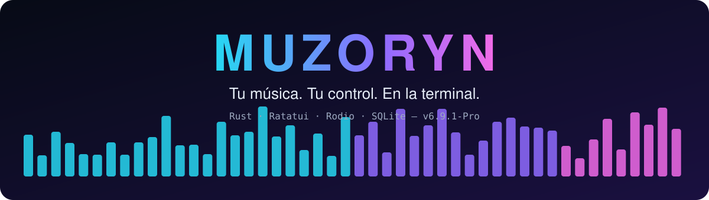

<br>

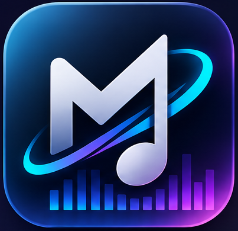

### Un reproductor de música para la terminal, rápido, bonito y 100 % controlable con el teclado


**[⚡ Instalar](#-instalación-paso-a-paso) · [🔄 Actualizar](#-actualizar-desde-una-versión-anterior) · [🎧 Primer uso](#-tu-primera-canción-en-3-minutos) · [🖥️ Terminales](#️-configura-tu-terminal) · [🆕 Novedades](#-novedades-de-70) · [📸 Capturas](#-galería-de-capturas) · [⌨️ Atajos](#️-chuleta-de-atajos) · [📘 Documentación](docs/README.md) · [🩺 Comprobar](#-comprueba-que-todo-funciona) · [🆘 Problemas](#-solución-de-problemas)**

</div>

---

## 📖 ¿Qué es MUZORYN?

MUZORYN es un reproductor de música que **vive dentro de la terminal** (la ventana negra de comandos). No necesitas ratón: todo se maneja con el teclado, es muy ligero y se ve genial.

> 🧒 **¿Eres novato?** Este README está pensado para ti. Cada sección te lleva de la mano. Si algo no se entiende, abre un *issue* y lo mejoramos.

<div align="center">
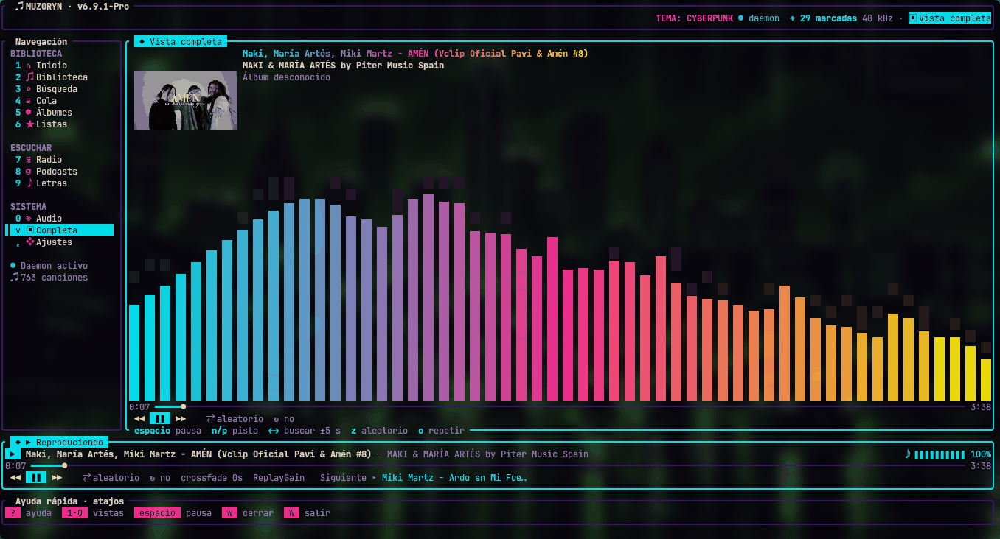
<br>
<sub>📸 Captura real en Kitty · tema <b>Cyberpunk</b> · vista completa con espectro</sub>
</div>

<div align="center">
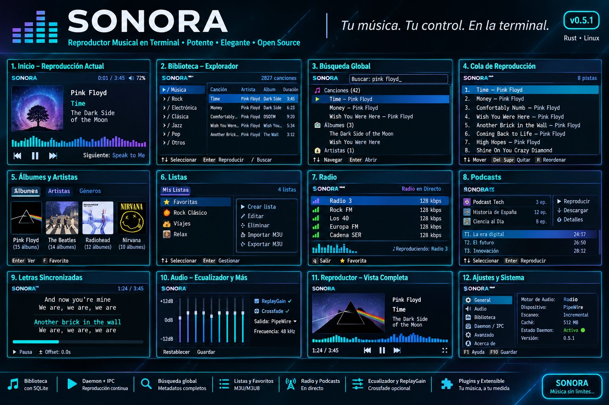
<br>
<sub>🎨 <b>Imagen de diseño de referencia</b> de las 12 vistas. Fue creada con el nombre antiguo del proyecto («Sonora»); la aplicación actual se llama <b>MUZORYN</b> y respeta esta distribución.</sub>
</div>

### ✨ Lo que puedes hacer

| | Función | Detalle |
|---|---|---|
| 🎵 | **Biblioteca local** | Escanea tu carpeta de música (mp3, flac, ogg/opus, wav, m4a/aac, aiff) y la guarda en SQLite |
| 🔍 | **Búsqueda instantánea** | Canciones, álbumes y artistas a la vez |
| 📻 | **Radio en directo** | Emisoras por URL o descubre miles con *Radio Browser*; favoritas ★, historial y canción en vivo |
| 🎙️ | **Podcasts en español** | Busca, suscríbete, marca episodios y descarga con un gestor de hasta 8 descargas a la vez |
| 🎚️ | **Ecualizador de 10 bandas** | Presets, ReplayGain y crossfade |
| 📊 | **10 visualizadores** | Espectro calculado del audio real que suena |
| 📝 | **Letras sincronizadas** | Con archivos `.lrc` |
| 🗂️ | **Listas** | Importa/exporta M3U, M3U8, PLS, TOML, XSPF y HTML; emisoras en M3U/M3U8, PLS, XSPF y JSON |
| 🎨 | **12 temas de color** | Cámbialos al vuelo con una tecla |
| 🧩 | **Daemon estilo MOC** | Cierra la ventana y la música sigue sonando |
| 🖼️ | **Carátulas reales** | En alta resolución en terminales compatibles |
| 🪝 | **Hooks** | Ejecuta tus comandos al cambiar de canción o al parar, con medidas de seguridad |
| ⏯️ | **Teclas multimedia (MPRIS 2)** | `playerctl`, las teclas del teclado y los widgets del escritorio controlan MUZORYN sin configurar nada |
| 🔗 | **Gapless** *(experimental)* | Con crossfade 0, las pistas locales se encadenan sin silencio entre ellas |

---

## 🆕 Novedades de 7.0

### 🧪 Próxima versión (en desarrollo)

> Estas funciones compilan y pasan las pruebas automáticas, pero **falta validarlas a mano en Linux real** (audio continuo y control por D-Bus). Mira el apartado «Sin publicar» del [CHANGELOG](CHANGELOG.md).

| | Novedad | Cómo se usa | Más |
|---|---|---|---|
| ⏯️ | **MPRIS 2** | Activo por defecto en el daemon: `playerctl -p muzoryn status`, teclas multimedia y widgets del escritorio | [MPRIS](docs/mpris.md) |
| 🔗 | **Gapless experimental** | Automático con crossfade 0 y pistas locales; diagnóstico con `MUZORYN_DEBUG_GAPLESS=1` | [Gapless](docs/gapless.md) |
| 🖼️ | **Carátulas sin parpadeo** | Se conserva la carátula anterior mientras carga la nueva y se precarga la de la siguiente pista | [Temas y terminales](docs/temas-y-terminales.md) |
| 🎙️ | **Podcasts por URL más estables** | Ya no aparece «Conectando…» ni se borra la duración si ya suena una pista | [Podcasts](docs/podcasts.md) |

### 🆕 Novedades de 7.0 y 7.0.1

> Resumen de lo nuevo desde la **6.9.1-Pro** (la última versión publicada) hasta la **7.0.1**. El detalle completo está en [CHANGELOG.md](CHANGELOG.md) y en la [documentación](docs/README.md).

<div align="center">
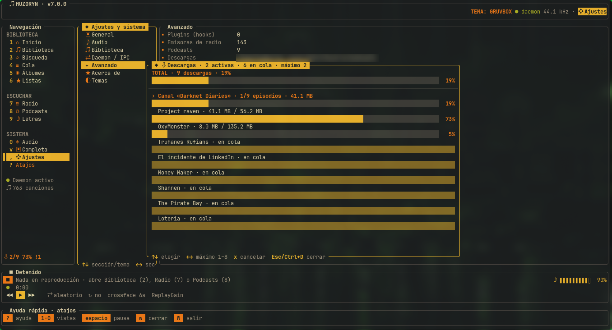
<br>
<sub>📸 Gestor de descargas <kbd>Ctrl</kbd>+<kbd>D</kbd>: barra TOTAL, canal completo, episodios activos y en cola</sub>
</div>

| | Novedad | Cómo se usa | Más |
|---|---|---|---|
| ⬇️ | **Gestor de descargas** | <kbd>Ctrl</kbd>+<kbd>D</kbd> o <kbd>F3</kbd> abre la ventana; <kbd>↑</kbd>/<kbd>↓</kbd> eligen, <kbd>←</kbd>/<kbd>→</kbd> ajustan el máximo (1–8), <kbd>x</kbd> cancela | [Descargas](docs/descargas.md) |
| ☑️ | **Marcar episodios** | En Podcasts → Episodios: <kbd>m</kbd> marca (✓), <kbd>M</kbd> quita marcas, <kbd>d</kbd> descarga las marcadas. Con 2 o más marcadas elige **en paralelo** o **en cola** | [Podcasts](docs/podcasts.md) |
| 📦 | **Canal completo** | <kbd>D</kbd> descarga todos los episodios que falten (confirma pulsando <kbd>D</kbd> otra vez); comparte cola y límite con <kbd>d</kbd> | [Descargas](docs/descargas.md) |
| 📶 | **Descargas más robustas** | Reintentos (hasta 3), límites de tiempo y velocidad mínima, nombres repetidos sin pisarse (`Título [hash].ext`) | [Descargas](docs/descargas.md) |
| ▶️ | **Streaming de podcasts con búfer** | Se reproduce sin bajar el episodio entero y se reanuda con HTTP Range si se corta | [Podcasts](docs/podcasts.md) |
| 📁 | **Carpetas de música desde la interfaz** | <kbd>Alt</kbd>+<kbd>M</kbd>: <kbd>Enter</kbd> entra, <kbd>s</kbd> añade, <kbd>x</kbd> quita, <kbd>Backspace</kbd> sube. Funciona con USB y discos externos | [Biblioteca y listas](docs/biblioteca-y-listas.md) |
| 📻 | **Importar y exportar emisoras** | En Radio: <kbd>i</kbd> importa (M3U/M3U8, PLS, XSPF, JSON) y <kbd>Ctrl</kbd>+<kbd>E</kbd> exporta | [Radio](docs/radio.md) |
| 🗂️ | **PLS en listas musicales** | Nuevo formato de importación/exportación (guarda el nombre de la lista) | [Biblioteca y listas](docs/biblioteca-y-listas.md) |
| 🪝 | **Hooks seguros** | `muzoryn hooks list\|add\|remove\|restore`, confianza de permisos, cuarentena y límite de 30 s | [Hooks](docs/hooks.md) |
| 🔒 | **Seguridad** | Redirecciones controladas (sin HTTPS→HTTP), instalador de Rust verificado con SHA-256, cierre ordenado del daemon | [Seguridad](docs/seguridad.md) |
| ⚡ | **Daemon más ligero** | El estado ya no se reenvía si no cambia: 100 ms sonando, 250 ms en pausa | [Daemon](docs/daemon-y-control.md) |
| 🧪 | **Más pruebas** | Pruebas unitarias y de interfaz, ejecutables con un solo comando (`./test.sh`) | [Desarrollo](docs/desarrollo.md) |

## 📸 Galería de capturas

> Las capturas de la sección general son de la **6.9.1-Pro** en **Kitty**; las de «Novedades 7.0» son de la **7.0** en **foot** con el tema **Gruvbox**. Haz clic en cada pestaña para desplegarla.

<details open>
<summary><b>🆕 Novedades 7.0</b> · carpetas, Radio Browser, importación, podcasts y descargas</summary>
<br>

**📁 Gestor de carpetas de música** (<kbd>Alt</kbd>+<kbd>M</kbd>)

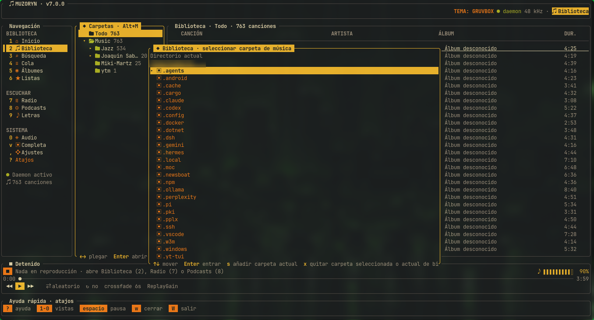

**📻 Explorar Radio Browser** con filtros en español

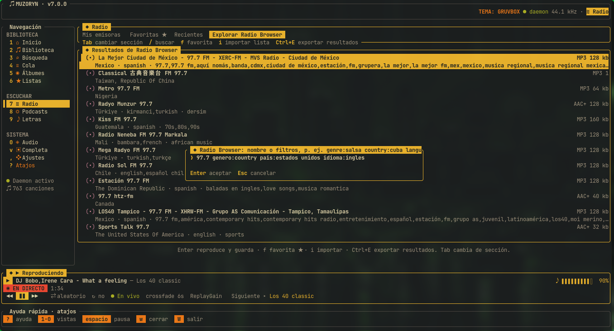

**📥 Importar lista de emisoras** (<kbd>i</kbd> en Radio)

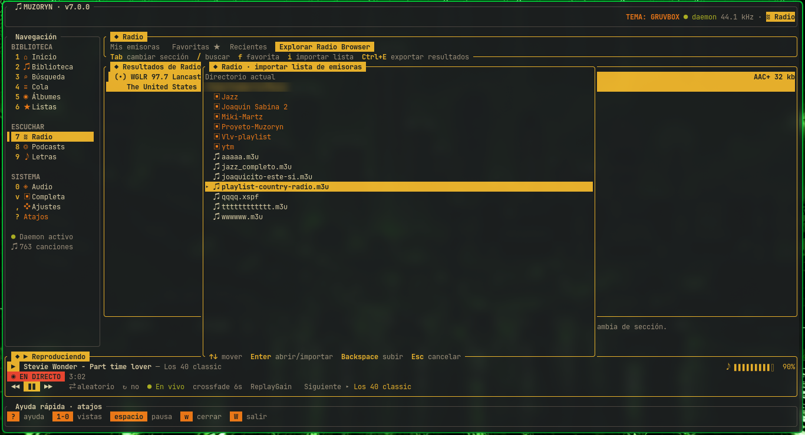

**🎙️ Mis podcasts** con detalles y carátula

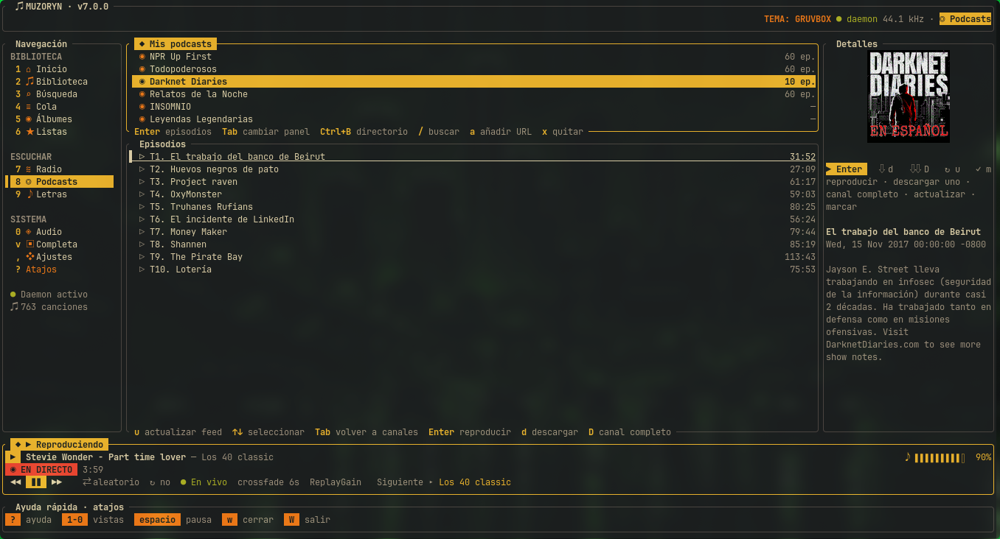

**☑️ Episodios marcados** (el indicador lateral muestra las descargas)

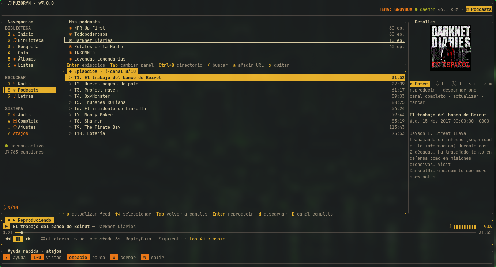

**⚙️ Ajustes → Avanzado** (descargas paralelas, hooks, emisoras, podcasts)

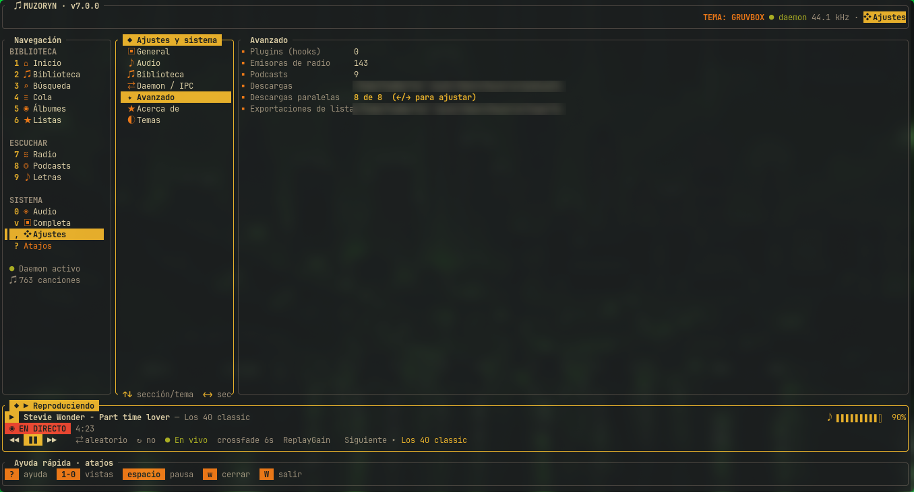

</details>

<details open>
<summary><b>🏠 Inicio (1)</b> · portada, espectro, cola</summary>
<br>
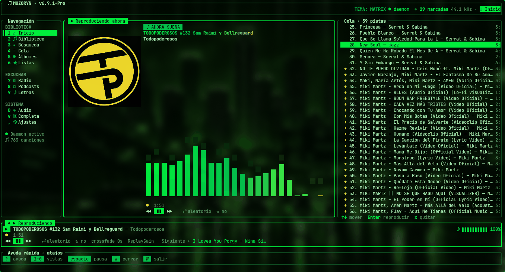
</details>

<details>
<summary><b>📚 Biblioteca (2)</b> · árbol de carpetas + tabla de canciones</summary>
<br>
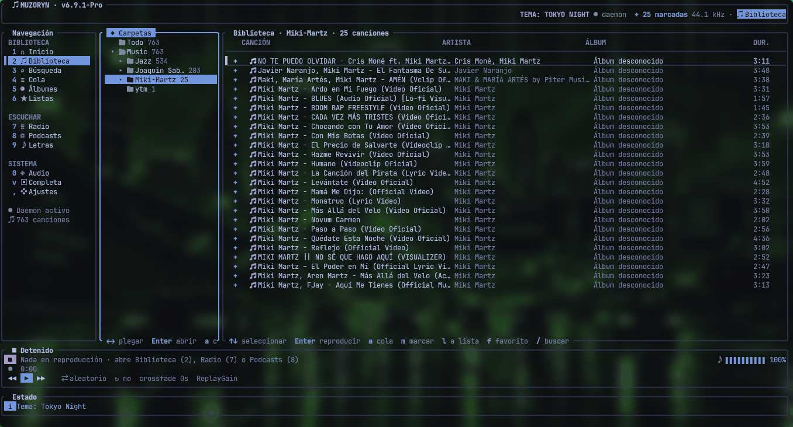
</details>

<details>
<summary><b>🔍 Búsqueda (3)</b> · canciones, álbumes y artistas a la vez</summary>
<br>
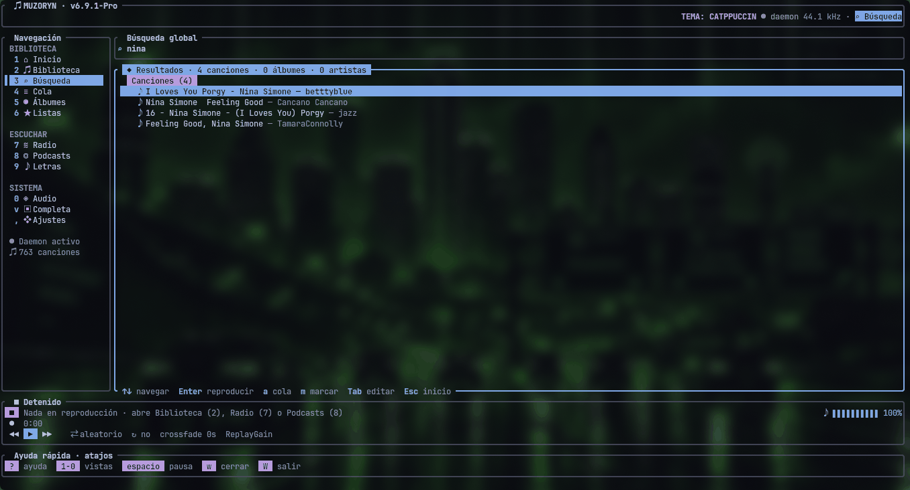
</details>

<details>
<summary><b>🧾 Cola (4)</b> · reordena, quita y vacía</summary>
<br>
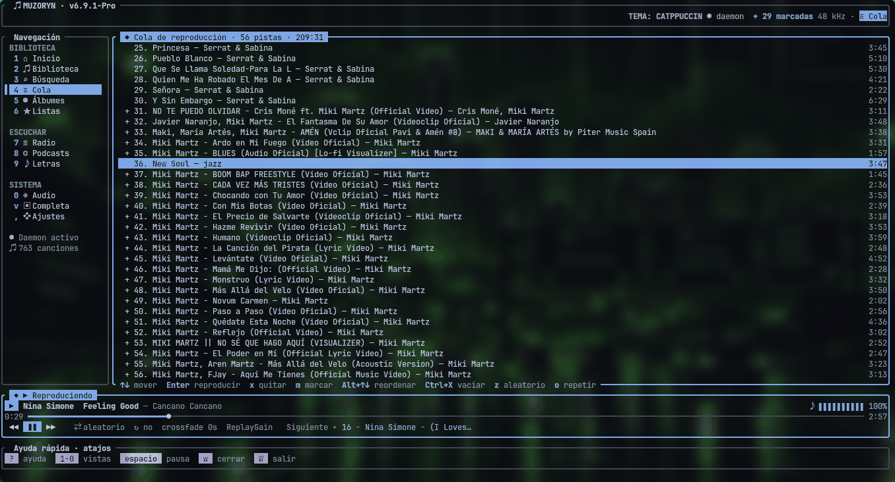
</details>

<details>
<summary><b>📻 Radio (7)</b> · favoritas ★ y canción en vivo</summary>
<br>
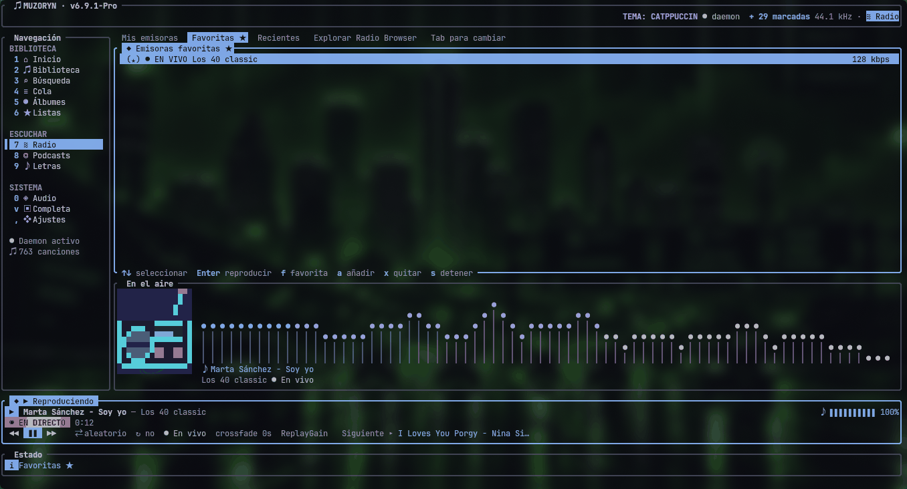
</details>

<details>
<summary><b>🎙️ Podcasts (8)</b> · episodios con carátula</summary>
<br>
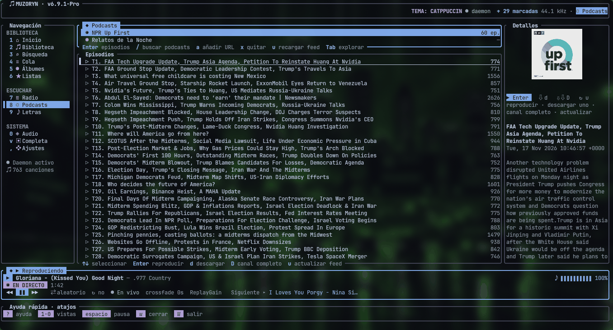
</details>

<details>
<summary><b>🎚️ Audio y EQ (0)</b> · ecualizador de 10 bandas</summary>
<br>
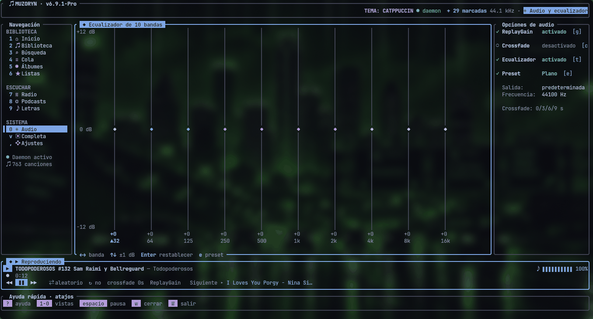
</details>

<details>
<summary><b>📊 Visualizadores y temas</b> · 4 ejemplos</summary>
<br>

| Nocturne | Matrix |
|:-:|:-:|
| 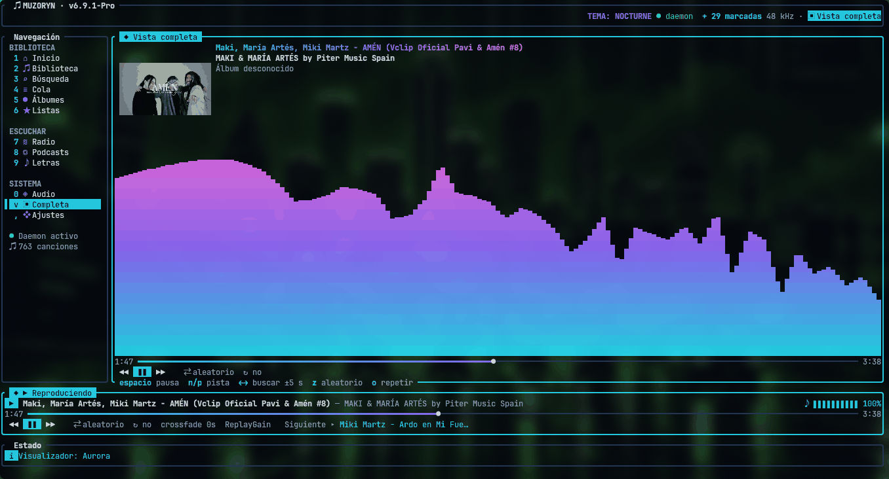 | 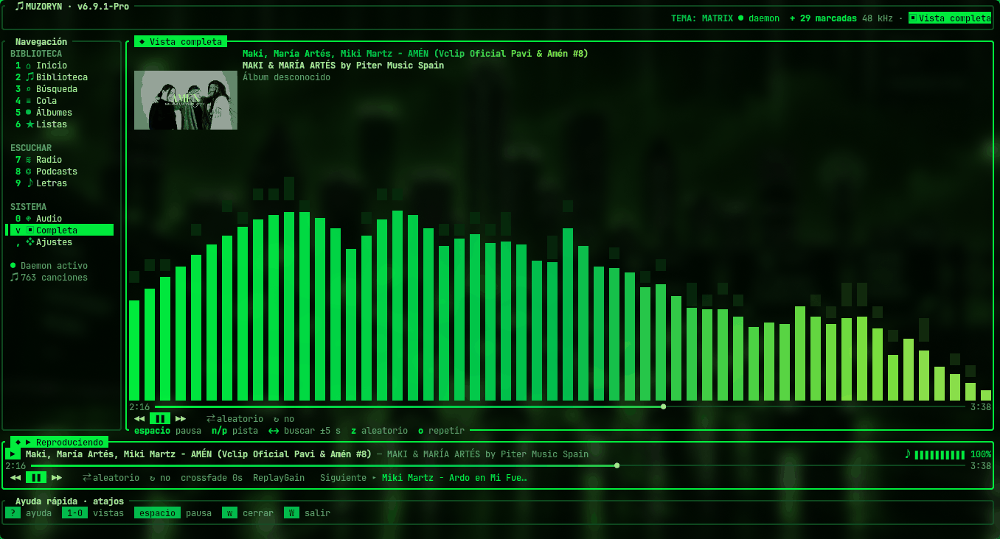 |
| **Atardecer** | **Daylight** (tema claro) |
| 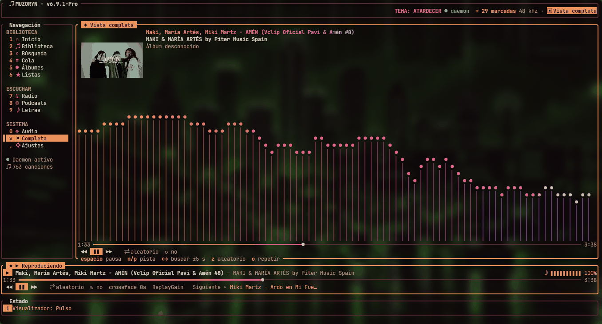 | 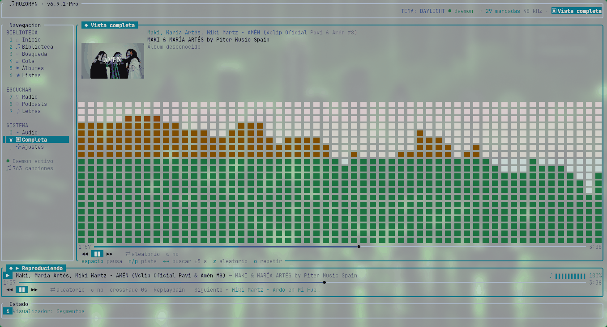 |

</details>

---

## ⚡ Instalación paso a paso

> **Resumen en 10 segundos:** descarga el proyecto → entra en la carpeta → ejecuta `./install.sh`. El instalador detecta tu distribución, instala las dependencias y compila todo por ti.

### Paso 0 · ¿Cómo abro una terminal?

<details>
<summary><b>🐧 Linux</b></summary>

Pulsa <kbd>Ctrl</kbd>+<kbd>Alt</kbd>+<kbd>T</kbd> o busca «Terminal» en el menú de aplicaciones.
</details>

<details>
<summary><b>🍎 macOS / 🪟 Windows (WSL)</b></summary>

El instalador automático está diseñado para **Linux**. En macOS puedes intentar la [instalación manual](#opción-c--manual-con-cargo) (sin garantía: no se ha probado). En Windows usa **WSL2** con Ubuntu y sigue las instrucciones de Linux; el audio dentro de WSL depende de tu configuración.
</details>

### Paso 1 · Descarga el proyecto

```bash
git clone https://github.com/novum-humberto/muzoryn.git
cd muzoryn
```

> 🔁 ¿Sin `git`? Pulsa el botón verde **Code → Download ZIP**, descomprime y entra en la carpeta.

### Paso 2 · Elige tu método

#### Opción A · Instalador automático (recomendado ⭐)

```bash
chmod +x install.sh uninstall.sh   # solo si no tienen permiso de ejecución
./install.sh
```

Esto instala **solo para tu usuario** en `~/.local` (no pide contraseña salvo para las dependencias).

> 🔒 Si falta Rust ≥ 1.82, el instalador **te pide confirmación** y descarga `rustup-init` por HTTPS **verificando su SHA-256** antes de ejecutarlo. Ya no usa `curl | sh`. Sin terminal interactiva exige `--yes`.

<details>
<summary><b>🔧 Opciones del instalador</b></summary>

| Opción | Qué hace |
|---|---|
| `--user` | Instala solo para tu usuario en `~/.local` *(por defecto si no eres root)* |
| `--system` | Instala para todos en `/usr/local` (usa `sudo`) |
| `--prefix DIR` | Instala en otra carpeta que tú elijas |
| `--no-deps` | No instala dependencias (úsalo si ya las tienes) |
| `-y`, `--yes` | Modo no interactivo (también confirma la descarga verificada de rustup si falta Rust) |
| `-h`, `--help` | Muestra la ayuda |

```bash
./install.sh --system          # para todos los usuarios
./install.sh --no-deps         # ya tengo Rust y las librerías
./install.sh --prefix ~/apps   # carpeta personalizada
```
</details>

#### Opción B · Instalación manual por distribución

Elige la pestaña de tu sistema, instala las dependencias y luego salta a la [Opción C](#opción-c--manual-con-cargo).

<details>
<summary></summary>

```bash
sudo apt update
sudo apt install -y build-essential pkg-config libasound2-dev curl ca-certificates cargo rustc
```
</details>

<details>
<summary></summary>

```bash
sudo pacman -S --needed base-devel alsa-lib pkgconf curl rust
```
</details>

<details>
<summary></summary>

```bash
sudo dnf install -y gcc make pkgconf-pkg-config alsa-lib-devel curl cargo rust
```
</details>

<details>
<summary></summary>

```bash
sudo zypper install gcc make pkg-config alsa-devel curl cargo rust
```
</details>

<details>
<summary></summary>

```bash
sudo apk add build-base pkgconf alsa-lib-dev curl cargo rust
```
</details>

<details>
<summary></summary>

```bash
sudo xbps-install -Sy base-devel alsa-lib-devel pkg-config curl cargo rust
```
</details>

> ⚠️ Necesitas **Rust ≥ 1.82**. Comprueba con `rustc --version`. Si tu distribución trae una versión más antigua, instala la oficial desde [rustup.rs](https://rustup.rs) (sigue las instrucciones de esa página) o deja que `./install.sh` lo haga con descarga verificada.

#### Opción C · Manual con Cargo

```bash
cargo build --release          # compila (tarda unos minutos la primera vez)
./target/release/muzoryn       # ejecútalo directamente
```

Para instalarlo en tu sistema sin el script:

```bash
install -Dm755 target/release/muzoryn ~/.local/bin/muzoryn
mkdir -p ~/.local/share/muzoryn/themes && cp themes/*.toml ~/.local/share/muzoryn/themes/
```

### Paso 3 · Que el sistema encuentre el comando

Si al terminar el instalador ve un aviso sobre el `PATH`, añade esta línea a tu `~/.bashrc` (o `~/.zshrc`) y reabre la terminal:

```bash
export PATH="$HOME/.local/bin:$PATH"
```

### Paso 4 · Comprueba la instalación

```bash
muzoryn --version
```

Debes ver algo como:

```text
muzoryn 7.0.1
```

✅ ¡Listo! Ya puedes pasar a la siguiente sección.

### 🔄 Actualizar desde una versión anterior

Si ya tienes MUZORYN instalado (por ejemplo la 6.9.1-Pro) y quieres pasar a la 7.0.1, **tus ajustes, biblioteca, listas, podcasts y favoritas se conservan** con cualquiera de los dos métodos: viven en `~/.config/muzoryn` y `~/.local/share/muzoryn`, que el instalador y el desinstalador normal no tocan. Las opciones nuevas (como `parallel_downloads`) toman su valor por defecto; no tienes que editar nada.

> ⚠️ **No uses `--purge` para actualizar:** borra tu configuración, biblioteca, listas y podcasts.

**Paso 1 · Consigue la versión nueva**

```bash
cd muzoryn && git pull        # si clonaste el repositorio
```

¿Descargaste el ZIP? En GitHub pulsa **Code → Download ZIP** (o descarga la *release*), descomprímelo en una carpeta nueva y entra en ella.

**Paso 2 · Elige un método**

| | Método A · Desinstalar y reinstalar ⭐ | Método B · Instalar encima |
|---|---|---|
| Cuándo | **Recomendado.** Siempre funciona y no deja restos | Más rápido si ya instalaste con las mismas opciones |
| Qué hace | Borra el programa anterior y vuelve a instalar | Sobrescribe el programa, los temas, los iconos y la documentación instalados |
| Restos de versiones viejas | Ninguno | Pueden quedar archivos que la versión nueva ya no usa |

#### Método A · Desinstalar y reinstalar (recomendado ⭐)

```bash
muzoryn ctl quit              # cierra el daemon antiguo (el desinstalador también lo intenta)
./uninstall.sh                # SIN --purge: conserva tus datos
./install.sh                  # con las mismas opciones que usaste la primera vez
muzoryn --version             # debe mostrar: muzoryn 7.0.1
```

#### Método B · Instalar encima

```bash
muzoryn ctl quit              # cierra el daemon antiguo
./install.sh                  # con las MISMAS opciones que usaste la primera vez
muzoryn --version             # debe mostrar: muzoryn 7.0.1
```

> 💡 **Usa las mismas opciones de instalación.** Si instalaste con `--system` o `--prefix ~/apps`, repítelas. Si cambias de ubicación, la versión antigua seguirá instalada en la otra y podrían convivir dos copias. Para comprobarlo: `which -a muzoryn` debe mostrar **una sola** ruta.

**Paso 3 · Comprueba**

- `muzoryn --version` → `muzoryn 7.0.1`.
- Abre `muzoryn`: tu biblioteca, emisoras y podcasts deben estar donde los dejaste.
- Si usabas **hooks** y no se ejecutan, mira [docs/hooks.md](docs/hooks.md): desde la 7.0.1 solo se activan si `settings.toml` y su carpeta no son escribibles por otros usuarios.

Más detalle en [docs/instalacion.md](docs/instalacion.md#actualizar).

### 🗑️ Desinstalar

```bash
./uninstall.sh            # borra el programa, conserva tus ajustes y biblioteca
./uninstall.sh --purge    # borra TAMBIÉN configuración, biblioteca, listas y podcasts
```

---

## 🎧 Tu primera canción en 3 minutos

```text
 ① Abre la terminal ──► ② escribe: muzoryn ──► ③ pulsa  2  ──► ④ elige canción ──► ⑤ Enter ▶
```

**1.** Escribe `muzoryn` y pulsa Enter. La primera vez crea su configuración y **abre un navegador para que elijas tu carpeta de música** (<kbd>Enter</kbd> entra, <kbd>s</kbd> añade la carpeta actual). Después escanea esa carpeta.

**2.** Pulsa <kbd>2</kbd> para abrir la **Biblioteca**. A la izquierda están las carpetas, a la derecha las canciones.

**3.** Muévete con <kbd>↑</kbd> <kbd>↓</kbd>, cambia de panel con <kbd>Tab</kbd> y pulsa <kbd>Enter</kbd> para reproducir.

**4.** Pausa con <kbd>Espacio</kbd>, siguiente con <kbd>n</kbd>, volumen con <kbd>=</kbd> / <kbd>-</kbd>.

**5.** Cuando quieras, pulsa <kbd>w</kbd> para cerrar la ventana **sin parar la música**. Para salir del todo, <kbd>W</kbd> (mayúscula).

> 📁 **¿Quieres añadir o quitar carpetas más tarde?** Pulsa <kbd>Alt</kbd>+<kbd>M</kbd> (incluye USB y discos externos) o edita `music_dirs` en [Configuración](#️-configuración). También puedes abrir carpetas directamente:
> ```bash
> muzoryn ~/Descargas/MiAlbum
> muzoryn cancion.flac otra.mp3
> ```

---

## 🖥️ Configura tu terminal

MUZORYN funciona en cualquier terminal moderna, pero se ve **mucho mejor** con estos dos ajustes:

### 1️⃣ Instala una fuente Nerd Font

Sin ella los iconos de carpetas pueden verse como cuadritos ▯. Descarga una en [nerdfonts.com](https://www.nerdfonts.com/font-downloads) (por ejemplo *JetBrainsMono Nerd Font*), instálala y selecciónala en tu terminal.

### 2️⃣ Quita el margen (padding) de la terminal

Así la interfaz ocupa toda la ventana. Busca tu terminal:

<details>
<summary><b>🐱 Kitty</b> · <code>~/.config/kitty/kitty.conf</code></summary>

```conf
window_padding_width 0
placement_strategy top-left
```
</details>

<details>
<summary><b>⬛ Alacritty</b> · <code>~/.config/alacritty/alacritty.toml</code></summary>

```toml
[window]
padding = { x = 0, y = 0 }
dynamic_padding = false
```
</details>

<details>
<summary><b>🦶 foot</b> · <code>~/.config/foot/foot.ini</code></summary>

```ini
[main]
pad=0x0
```
</details>

<details>
<summary><b>👻 Ghostty</b> · <code>~/.config/ghostty/config</code></summary>

```ini
window-padding-x = 0
window-padding-y = 0
window-padding-color = extend
```
</details>

<details>
<summary><b>🌀 WezTerm</b> · <code>~/.config/wezterm/wezterm.lua</code></summary>

```lua
config.window_padding = { left = 0, right = 0, top = 0, bottom = 0 }
```
</details>

> 💡 Si ves un borde de color alrededor, suele venir de tu gestor de ventanas (p. ej. `col.active_border` en Hyprland) o de la transparencia de la terminal, **no** de MUZORYN.
> MUZORYN pinta el fondo de la terminal con el color del tema (secuencia OSC 11) y lo restaura al salir. Para desactivarlo: `MUZORYN_NO_OSC=1 muzoryn`.

### 🖼️ Carátulas en alta resolución

| Terminal | Protocolo de imagen |
|---|---|
| Kitty · WezTerm · Ghostty | Kitty |
| iTerm2 · mintty | iTerm2 |
| foot · mlterm · Konsole | Sixel |
| Cualquier otra (y dentro de **tmux**) | Medios bloques (96 px) |

Para forzar un modo:

```bash
MUZORYN_GRAPHICS=kitty muzoryn      # kitty | iterm | sixel | blocks
```

---

## 🗺️ Las 12 vistas

<div align="center">
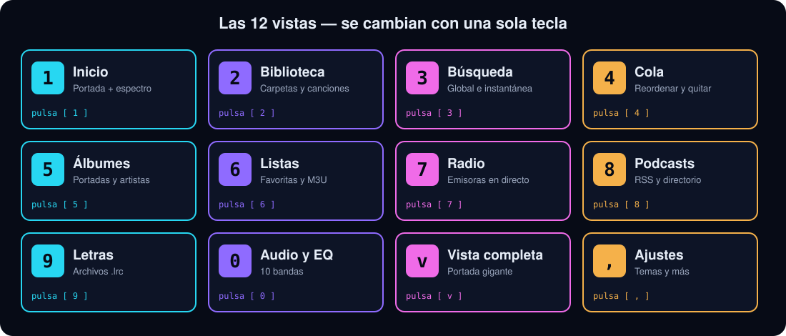
</div>

<details>
<summary><b>📚 Qué hace cada vista (haz clic para desplegar)</b></summary>

| Tecla | Vista | Qué hace |
|:-:|---|---|
| <kbd>1</kbd> | **Inicio** | Portada, espectro en vivo, controles y cola |
| <kbd>2</kbd> | **Biblioteca** | Árbol de carpetas (<kbd>→</kbd> despliega, <kbd>←</kbd> pliega) + tabla de canciones. <kbd>a</kbd> en una carpeta la añade entera a la cola. <kbd>Alt</kbd>+<kbd>M</kbd> gestiona las carpetas de música |
| <kbd>3</kbd> | **Búsqueda** | Búsqueda global instantánea |
| <kbd>4</kbd> | **Cola** | Reordenar (<kbd>Alt</kbd>+<kbd>↑↓</kbd>), quitar, vaciar (<kbd>Ctrl</kbd>+<kbd>X</kbd>) |
| <kbd>5</kbd> | **Álbumes y artistas** | Cuadrícula con portadas; pestañas Álbumes / Artistas / Géneros |
| <kbd>6</kbd> | **Listas** | Favoritas y tus listas; importar y exportar |
| <kbd>7</kbd> | **Radio** | Emisoras HTTP en directo, Radio Browser, importar/exportar |
| <kbd>8</kbd> | **Podcasts** | Feeds RSS, directorio en español, marcado y descargas (<kbd>Ctrl</kbd>+<kbd>D</kbd>) |
| <kbd>9</kbd> | **Letras** | Letras `.lrc` con desfase ±0,5 s (<kbd>[</kbd> <kbd>]</kbd>) |
| <kbd>0</kbd> | **Audio y EQ** | Ecualizador de 10 bandas, ReplayGain, crossfade |
| <kbd>v</kbd> | **Vista completa** | Portada grande y espectro a pantalla completa |
| <kbd>,</kbd> | **Ajustes** | General, Audio, Biblioteca, Daemon/IPC, Avanzado, Acerca de y Temas |

</details>

---

## ⌨️ Chuleta de atajos

<div align="center">
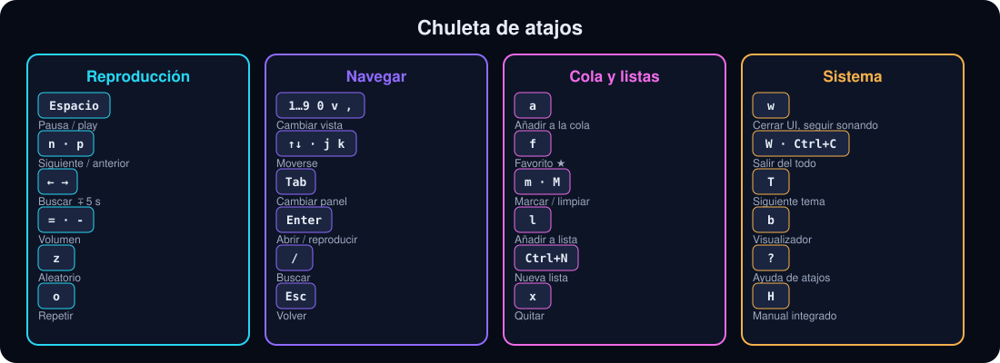
</div>

> 🆘 Dentro de la app: <kbd>?</kbd> muestra los atajos y <kbd>H</kbd> abre el **manual integrado**. Desde fuera: `muzoryn --man`. Lista completa en [docs/atajos.md](docs/atajos.md).

<details>
<summary><b>🔧 Cambiar los atajos</b></summary>

Copia el archivo de ejemplo y edítalo:

```bash
mkdir -p ~/.config/muzoryn
cp config/keys.toml ~/.config/muzoryn/keys.toml
nano ~/.config/muzoryn/keys.toml
```

```toml
[keys]
next = ["n", "ctrl+right"]   # un atajo propio REEMPLAZA todos los de esa acción
quit_all = ["W", "ctrl+c"]
```

Otro archivo: `MUZORYN_KEYS=/ruta/mis-atajos.toml muzoryn`
</details>

---

## 📻 Radio

<div align="center"></div>

1. Pulsa <kbd>7</kbd>.
2. **Añadir por URL:** <kbd>a</kbd> → pega la dirección del stream → Enter → escribe un nombre (o déjalo vacío).
3. **Descubrir:** <kbd>Tab</kbd> hasta **Explorar Radio Browser** → <kbd>/</kbd> y escribe tu búsqueda.

```text
género:salsa país:cuba idioma:español
```

(equivale a `genre:salsa country:cuba language:Spanish`; también funciona `country:`, `language:`, `genre:`.)

| Sección (<kbd>Tab</kbd> las recorre) | Para qué sirve |
|---|---|
| Mis emisoras | Las que has guardado |
| Favoritas ★ | Márcalas con <kbd>f</kbd> |
| Recientes | Las últimas 10 reproducidas |
| Explorar Radio Browser | Busca nuevas emisoras |

Estados que verás: `Conectando…` → `En vivo` → `Reconectando…` → `Emisora no disponible`. Si el stream se corta, se reintenta solo.

**Importar y exportar emisoras (nuevo en 7.0):**

| Tecla (en Radio) | Acción |
|:-:|---|
| <kbd>i</kbd> | Abre un navegador de archivos; elige un `.m3u`, `.m3u8`, `.pls`, `.xspf` o `.json`. Se **añaden** a tus emisoras y se omiten las URLs duplicadas |
| <kbd>Ctrl</kbd>+<kbd>E</kbd> | Exporta a M3U, M3U8, PLS, XSPF y JSON en `~/.local/share/muzoryn/exports/radio/`. En *Mis emisoras* exporta las guardadas; en *Radio Browser*, los resultados de la búsqueda actual |

Solo se aceptan direcciones `http://` y `https://`. Más detalle en [docs/radio.md](docs/radio.md).

> 🔒 **Privacidad:** al reproducir una emisora de Radio Browser se envía **solo su identificador** para contar popularidad. Desactívalo con `radio_click_count = false`. Las emisoras añadidas por URL no envían nada.

## 🎙️ Podcasts en español

<div align="center"></div>

Pulsa <kbd>8</kbd>:

| Tecla | Acción |
|:-:|---|
| <kbd>/</kbd> | Buscar por nombre o tema (ej. `historia de México`) |
| <kbd>Tab</kbd> | Alterna entre **Mis podcasts** y los **episodios** del canal seleccionado |
| <kbd>Ctrl</kbd>+<kbd>B</kbd> | Abre el directorio; <kbd>←</kbd>/<kbd>→</kbd> cambia entre **Populares** y **Categorías**; <kbd>Esc</kbd> vuelve |
| <kbd>Enter</kbd> | En un episodio lo reproduce; en el directorio abre una categoría o suscribe y abre los episodios |
| <kbd>f</kbd> | Suscribirse / cancelar sin abrir (en el directorio) |
| <kbd>d</kbd> | Descargar el episodio seleccionado (o **todos los marcados**) |
| <kbd>m</kbd> / <kbd>M</kbd> | Marcar o desmarcar un episodio (✓) / quitar todas las marcas |
| <kbd>D</kbd> | Descargar **el canal completo** (confirma pulsando <kbd>D</kbd> otra vez en 8 s) |
| <kbd>Ctrl</kbd>+<kbd>D</kbd> · <kbd>F3</kbd> | Abre el **gestor de descargas** |
| <kbd>u</kbd> | Actualizar el feed del canal (en Populares, recarga el catálogo) |
| <kbd>a</kbd> | Añadir un feed RSS por URL (<kbd>x</kbd> dos veces quita el canal) |

Con **dos o más episodios marcados**, <kbd>d</kbd> pregunta si quieres descargarlos **en paralelo** (hasta 8 a la vez) o **en cola** (de uno en uno): <kbd>↑</kbd>/<kbd>↓</kbd> eligen, <kbd>Enter</kbd> acepta y <kbd>Esc</kbd> cancela (las marcas se conservan).

El episodio se **reproduce en streaming** con un búfer en memoria (unos 4 MiB); si la conexión se corta intenta reanudar desde el byte pendiente cuando el servidor lo permite. La barra de progreso usa la duración que publica el feed (`itunes:duration`).

Las descargas van a `~/.local/share/muzoryn/podcasts/<canal>/`. Más en [docs/descargas.md](docs/descargas.md) y [docs/podcasts.md](docs/podcasts.md). Cambia el país de la tienda con `podcast_country` (`mx` por defecto; `es`, `ar`, `co`, `cl`, `pe`, `us`…).

---

## 🗂️ Listas y selección múltiple

1. <kbd>6</kbd> → elige la lista destino (o <kbd>Ctrl</kbd>+<kbd>N</kbd> para crear una).
2. Ve marcando pistas con <kbd>m</kbd> en Biblioteca, Álbumes, Búsqueda o Cola (las marcadas muestran `+`).
3. Pulsa <kbd>l</kbd> para añadirlas todas. <kbd>M</kbd> quita las marcas.

**Importar/exportar:** <kbd>i</kbd> abre un explorador de archivos; <kbd>Ctrl</kbd>+<kbd>E</kbd> exporta (deja vacío para generar todos los formatos: M3U, M3U8, PLS, TOML, XSPF y HTML en `~/.local/share/muzoryn/exports/`). Importar una lista **no** exige que los archivos existan: las entradas se conservan y las rutas `file://` o con `%20` se decodifican.

---

## 🎨 Temas de color

<div align="center">
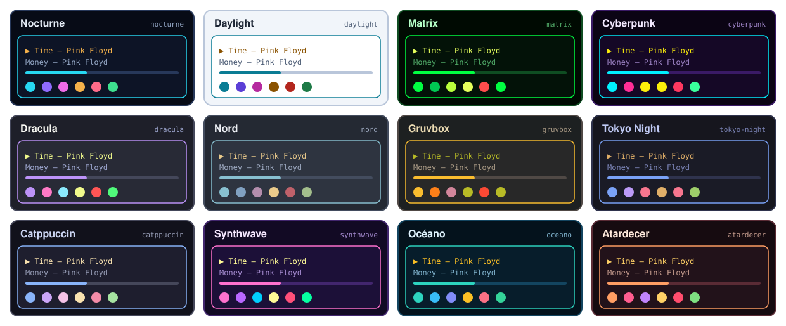
<br><sub>Paleta real tomada de los archivos de la carpeta <code>themes/</code>.</sub>
</div>

```bash
muzoryn                          # dentro de la app, pulsa  T  para rotar temas
MUZORYN_THEME=matrix muzoryn     # arrancar con un tema
```

Fijo en los ajustes: `theme = "nord"` en `settings.toml`. También puedes pasar la ruta a un `.toml` propio (copia uno de `themes/` y cambia los colores).

---

## ⚙️ Configuración

### 📍 ¿Dónde se guarda todo?

| Qué | Dónde |
|---|---|
| Ajustes | `~/.config/muzoryn/settings.toml` |
| Atajos | `~/.config/muzoryn/keys.toml` |
| Biblioteca | `~/.local/share/muzoryn/library.db` |
| Descargas y exportaciones | `~/.local/share/muzoryn/` |
| Socket del daemon | `$XDG_RUNTIME_DIR/muzoryn.sock` |

### 📝 Ejemplo de `settings.toml`

```toml
theme = "nocturne"
music_dirs = ["/home/yo/Music", "/mnt/disco/Musica"]
podcast_country = "mx"
radio_click_count = true
parallel_downloads = 8       # descargas simultáneas de episodios (1–8)

[[stations]]
name = "Mi radio"
url = "https://ejemplo.org/stream.mp3"
bitrate = 128

[[podcasts]]
name = "Mi podcast"
url = "https://ejemplo.org/feed.xml"

# Ejecuta un comando cada vez que cambia la canción
[[hooks]]
event = "track_changed"
command = "notify-send \"$MUZORYN_TITLE\" \"$MUZORYN_ARTIST\""
```

> Después de cambiar `music_dirs`, abre MUZORYN y pulsa <kbd>u</kbd> para re-escanear.

### 🌍 Variables de entorno

| Variable | Para qué |
|---|---|
| `MUZORYN_THEME` | Tema (nombre o ruta a `.toml`) |
| `MUZORYN_KEYS` | Archivo de atajos |
| `MUZORYN_SOCKET` | Ruta del socket del daemon |
| `MUZORYN_CONFIG_DIR` / `MUZORYN_DATA_DIR` | Cambiar carpetas de config y datos |
| `MUZORYN_GRAPHICS` | `kitty` · `iterm` · `sixel` · `blocks` |
| `MUZORYN_NO_OSC=1` | No cambiar el color de fondo de la terminal |
| `MUZORYN_DEBUG_GAPLESS=1` | Registrar el encadenado gapless en `/tmp/muzoryn-gapless.log` |

### 🪝 Hooks (plugins sencillos)

Eventos: `track_changed`, `playback_stopped`. Variables disponibles para tu comando: `MUZORYN_TITLE`, `MUZORYN_ARTIST`, `MUZORYN_ALBUM` (nunca se insertan dentro del comando, viajan como variables de entorno).

```bash
muzoryn hooks                                   # lista los hooks y si son de confianza
muzoryn hooks add track_changed 'notify-send "$MUZORYN_TITLE" "$MUZORYN_ARTIST"'
muzoryn hooks remove 1                          # elimina el hook número 1
muzoryn hooks restore --yes                     # recupera hooks puestos en cuarentena
```

> 🔒 **Seguridad (7.0.1):** los hooks solo se activan si `settings.toml` es tuyo y ni el archivo ni su carpeta son escribibles por otros usuarios. Si no, pasan a **cuarentena** (`settings.toml.hooks-en-cuarentena`) sin perderse. Cada hook tiene un límite de **30 s**, máximo **8 a la vez** y **16** en total. Detalle en [docs/hooks.md](docs/hooks.md).

---

## 🧩 Daemon y control desde fuera

<div align="center">
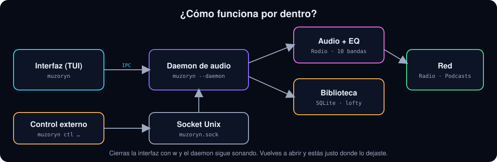
</div>

Al abrir `muzoryn`, el **daemon** arranca solo. Por eso puedes cerrar la ventana (<kbd>w</kbd>) y la música sigue.

```bash
muzoryn --daemon                 # daemon sin interfaz
muzoryn ctl toggle               # pausa / reanuda
muzoryn ctl next                 # siguiente
muzoryn ctl prev                 # anterior
muzoryn ctl vol+                 # volumen +   (vol- para bajar)
muzoryn ctl status               # ¿qué está sonando?
muzoryn ctl quit                 # detener el daemon
```

Órdenes disponibles: `toggle next prev stop vol+ vol- shuffle repeat forward back quit status`.

> 🔄 **Al actualizar de versión**, cierra el daemon antiguo con `muzoryn ctl quit` y vuelve a abrir MUZORYN, para que interfaz y daemon sean de la misma versión.

### ⏯️ Teclas multimedia del teclado

El daemon se registra en el bus de sesión de D-Bus como `org.mpris.MediaPlayer2.muzoryn` (**MPRIS 2**, activado por defecto). Las **teclas multimedia**, `playerctl` y los widgets del escritorio (GNOME, KDE, Waybar…) lo controlan sin configurar nada:

```bash
muzoryn --daemon &                 # o abre muzoryn normalmente
playerctl -p muzoryn status
playerctl -p muzoryn metadata
playerctl -p muzoryn play-pause
```

Detalle de lo que soporta en [docs/mpris.md](docs/mpris.md). Si tu sesión no tiene bus D-Bus, el daemon sigue sin MPRIS y avisa por `stderr`. Para compilar sin MPRIS: `cargo build --release --no-default-features`.

**Sin MPRIS**, enlaza tus teclas con `muzoryn ctl`:

<details>
<summary><b>Hyprland / Omarchy</b></summary>

```conf
bindl = , XF86AudioPlay, exec, muzoryn ctl toggle
bindl = , XF86AudioNext, exec, muzoryn ctl next
bindl = , XF86AudioPrev, exec, muzoryn ctl prev
bindl = , XF86AudioStop, exec, muzoryn ctl stop
```
</details>

<details>
<summary><b>sway / i3</b></summary>

```conf
bindsym XF86AudioPlay exec muzoryn ctl toggle
bindsym XF86AudioNext exec muzoryn ctl next
bindsym XF86AudioPrev exec muzoryn ctl prev
bindsym XF86AudioStop exec muzoryn ctl stop
```
</details>

---

## 🩺 Comprueba que todo funciona

Marca cada punto a medida que lo pruebes:

- [ ] `muzoryn --version` muestra `muzoryn 7.0.1`
- [ ] `muzoryn --help` muestra la ayuda
- [ ] `muzoryn` abre la interfaz con colores y sin caracteres rotos
- [ ] <kbd>2</kbd> muestra tus canciones (si no, pulsa <kbd>u</kbd> y revisa `music_dirs`)
- [ ] <kbd>Enter</kbd> sobre una canción **suena** 🔊
- [ ] <kbd>Espacio</kbd> pausa y reanuda
- [ ] <kbd>T</kbd> cambia el tema
- [ ] <kbd>w</kbd> cierra la ventana y **la música sigue sonando**; al volver a ejecutar `muzoryn`, estás en el mismo panel
- [ ] `muzoryn ctl status` responde mientras suena
- [ ] `playerctl -p muzoryn status` responde (MPRIS) y las teclas multimedia controlan la música
- [ ] <kbd>7</kbd> → Enter en una emisora (requiere Internet)
- [ ] <kbd>Ctrl</kbd>+<kbd>D</kbd> abre el gestor de descargas y <kbd>Esc</kbd> lo cierra

### 🧪 Para desarrolladores: pruebas automáticas

```bash
./test.sh
```

El comando comprueba formato, ejecuta todas las pruebas (incluido MPRIS, activado por defecto) y ejecuta Clippy. Solo necesitas este script durante el desarrollo; el usuario final no tiene que ejecutarlo.

> ⚠️ **Transparencia:** el audio real, la lectura de metadatos ICY contra emisoras reales, el aviso de clics a Radio Browser, la instalación en Arch Linux con descarga real de rustup y las redirecciones HTTPS→HTTP reales, la **continuidad audible del gapless** y el registro efectivo de **MPRIS** en el bus D-Bus del escritorio **no están verificados en pruebas automáticas** (no hay tarjeta de sonido ni salida a todos los servidores en el entorno de pruebas). Si una emisora suena mal o no muestra canción, abre un issue con su URL.

---

## 🆘 Solución de problemas

<details>
<summary><b>❌ <code>muzoryn: command not found</code></b></summary>

Falta añadir la carpeta al `PATH`:

```bash
export PATH="$HOME/.local/bin:$PATH"
```

Ponlo en `~/.bashrc` o `~/.zshrc` y reabre la terminal.
</details>

<details>
<summary><b>❌ Error al compilar: <code>alsa</code> / <code>pkg-config</code> no encontrado</b></summary>

Falta la librería de audio de desarrollo. Mira la sección [Instalación manual por distribución](#opción-b--instalación-manual-por-distribución) y ejecuta el comando de tu sistema (en Debian/Ubuntu: `libasound2-dev`).
</details>

<details>
<summary><b>❌ <code>rustc</code> demasiado antiguo</b></summary>

Necesitas Rust ≥ 1.82. Instala el oficial con [rustup](https://rustup.rs) y vuelve a ejecutar `./install.sh --no-deps`.
</details>

<details>
<summary><b>🔇 No suena nada</b></summary>

- Comprueba que el volumen del sistema no está en silencio y que otra app reproduce audio.
- Pulsa <kbd>=</kbd> para subir el volumen interno.
- En PipeWire/PulseAudio asegúrate de tener la capa de compatibilidad ALSA instalada.
- Prueba sin daemon: cierra todo con <kbd>W</kbd> o `muzoryn ctl quit` y vuelve a abrir.
</details>

<details>
<summary><b>🔲 Veo cuadritos ▯ en lugar de iconos</b></summary>

Instala una [Nerd Font](https://www.nerdfonts.com/font-downloads) y selecciónala en tu terminal.
</details>

<details>
<summary><b>🖼️ No salen las carátulas / salen borrosas</b></summary>

Tu terminal quizá no soporta gráficos, o estás dentro de **tmux** (usa bloques de baja resolución). Fuerza un modo con `MUZORYN_GRAPHICS=kitty|iterm|sixel|blocks`.
</details>

<details>
<summary><b>📂 Mi biblioteca está vacía</b></summary>

Revisa `music_dirs` en `~/.config/muzoryn/settings.toml` y pulsa <kbd>u</kbd> dentro de MUZORYN para escanear. Formatos admitidos: mp3, flac, ogg/opus, wav, m4a/aac, aiff.
</details>

<details>
<summary><b>📻 Una emisora no conecta</b></summary>

Se esperan hasta ~8 s para conectar. Pulsa <kbd>s</kbd> para cancelar y elige otra. Algunos formatos de stream pueden no estar soportados por el decodificador (Symphonia).
</details>

<details>
<summary><b>⚠️ Error de configuración al abrir</b></summary>

Un `settings.toml` o `keys.toml` con sintaxis inválida se informa antes de abrir la interfaz. Renombra el archivo (`mv settings.toml settings.toml.bak`) y MUZORYN creará uno nuevo.
</details>

---

## 🚧 Límites conocidos

- Las emisoras y feeds por defecto (SomaFM, Radio Paradise, NPR) son **ejemplos**: sustitúyelos por los tuyos.
- Los streams de red no admiten *seek* (avanzar/retroceder).
- El *gapless* es **experimental**: solo con crossfade 0 y pistas locales (no en radio ni podcasts). Ver [docs/gapless.md](docs/gapless.md).
- MPRIS no implementa `TrackList`, `OpenUri` ni `Seeked`. Ver [docs/mpris.md](docs/mpris.md).
- El daemon y el socket Unix están pensados para Linux/Unix.
- Con colas de miles de pistas conviene usar la interfaz integrada en lugar de un daemon remoto.
- Un cliente antiguo con un daemon nuevo (o al revés) puede mostrar la cola vacía: reinicia el daemon al actualizar (`muzoryn ctl quit`).
- La barra de progreso de un podcast necesita que el feed publique `itunes:duration`.

---

## 🏗️ Estructura del proyecto

```text
muzoryn/
├── src/
│   ├── core.rs        cola, estado, comandos, aleatorio/repetición, crossfade
│   ├── audio.rs       Rodio + cadena DSP (EQ, ganancia, espectro)
│   ├── dsp.rs         biquad, presets y espectro
│   ├── library.rs     SQLite, escaneo, favoritos, listas, M3U
│   ├── media.rs       elementos de cola, lector HTTP y metadatos ICY
│   ├── ipc.rs         daemon y cliente por socket Unix
│   ├── mpris.rs       MPRIS 2 por D-Bus (teclas multimedia, playerctl)
│   ├── feeds.rs       RSS y descargas de episodios
│   ├── downloads.rs   gestor de descargas (cola, límite, progreso)
│   ├── hooks.rs       hooks: confianza, cuarentena y ejecución
│   ├── playlist_io.rs / radio_playlist_io.rs   importar y exportar listas y emisoras
│   ├── radio_browser.rs / podcast_directory.rs   directorios en línea
│   ├── app.rs · ui.rs · widgets.rs · theme.rs    interfaz y temas
│   └── main.rs        arranque y línea de comandos
├── themes/            12 temas .toml
├── config/keys.toml   atajos de ejemplo
├── tests/tui.rs       pruebas de interfaz
├── .github/           CI, plantillas de issues y de pull requests
├── install.sh · uninstall.sh · test.sh
├── CHANGELOG.md       historial de cambios
├── CONTRIBUTING.md · SECURITY.md
└── docs/              documentación completa e imágenes del README
```

---

## 📘 Documentación completa

Toda la documentación de la aplicación está en **[docs/README.md](docs/README.md)**:

| Tema | Página |
|---|---|
| ⚡ Instalar, actualizar y desinstalar | [docs/instalacion.md](docs/instalacion.md) |
| 🎧 Primeros pasos | [docs/primeros-pasos.md](docs/primeros-pasos.md) |
| 🗺️ Las 12 vistas | [docs/vistas.md](docs/vistas.md) |
| ⌨️ Todos los atajos y cómo cambiarlos | [docs/atajos.md](docs/atajos.md) |
| 📚 Biblioteca, carpetas y listas | [docs/biblioteca-y-listas.md](docs/biblioteca-y-listas.md) |
| 📻 Radio y Radio Browser | [docs/radio.md](docs/radio.md) |
| 🎙️ Podcasts | [docs/podcasts.md](docs/podcasts.md) |
| ⬇️ Gestor de descargas | [docs/descargas.md](docs/descargas.md) |
| 🧩 Daemon y control externo | [docs/daemon-y-control.md](docs/daemon-y-control.md) |
| ⏯️ MPRIS (teclas multimedia, `playerctl`) | [docs/mpris.md](docs/mpris.md) |
| 🔗 Gapless (sin cortes entre pistas) | [docs/gapless.md](docs/gapless.md) |
| ⚙️ Configuración (`settings.toml`) | [docs/configuracion.md](docs/configuracion.md) |
| 🪝 Hooks | [docs/hooks.md](docs/hooks.md) |
| 🎨 Temas y terminales | [docs/temas-y-terminales.md](docs/temas-y-terminales.md) |
| 🔒 Seguridad y privacidad | [docs/seguridad.md](docs/seguridad.md) |
| 🆘 Solución de problemas | [docs/solucion-de-problemas.md](docs/solucion-de-problemas.md) |
| 🧪 Desarrollo y pruebas | [docs/desarrollo.md](docs/desarrollo.md) |
| 🧾 Historial de cambios | [CHANGELOG.md](CHANGELOG.md) |

---

## 🤝 Contribuir

1. Haz un *fork* del repositorio.
2. Crea una rama: `git checkout -b mi-mejora`
3. Prueba que todo pasa: `./test.sh`
4. Abre un *Pull Request* explicando el cambio. Más detalle en [CONTRIBUTING.md](CONTRIBUTING.md).

¿Encontraste un fallo? Abre un *issue* con: tu distribución, tu terminal, la versión (`muzoryn --version`) y los pasos para reproducirlo.

## 📜 Licencia

MIT — consulta el archivo `LICENSE`.

<div align="center">

<br>

**Hecho con 🦀 Rust y mucho ♥ por la música.**

⭐ Si te gusta, ¡dale una estrella al repositorio!

</div>
