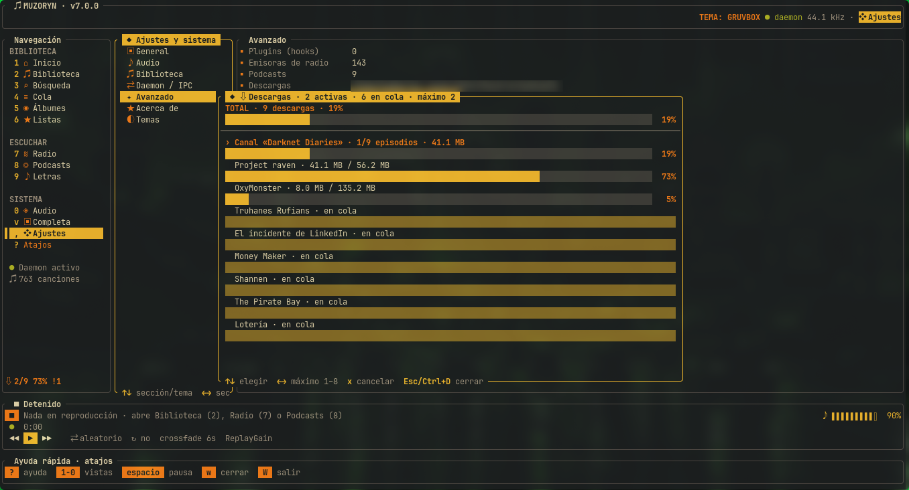
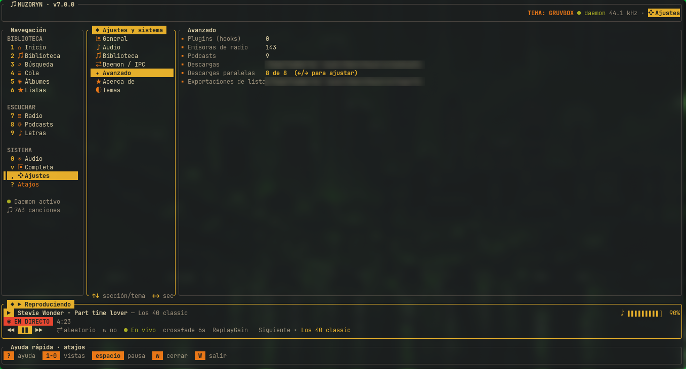

# ⬇️ Gestor de descargas

Todas las descargas de episodios pasan por un único gestor: `d` (uno o varios marcados), `D` (canal completo) y el estado de cada una se ven en **`Ctrl+D`** o **`F3`**.

## Cómo descargar
| Quiero… | Haz esto |
|---|---|
| Un episodio | Selecciónalo en Podcasts → Episodios y pulsa `d` |
| Varios episodios | Márcalos con `m` (✓) y pulsa `d`. `M` quita las marcas |
| Todo el canal | Pulsa `D` y **confirma pulsando `D` otra vez en 8 s** |
| Cancelar el canal completo | `D` otra vez durante la descarga, o `x` sobre la fila del canal en `Ctrl+D` |

Con **dos o más episodios marcados**, `d` abre un diálogo: **en paralelo** (hasta 8 a la vez) o **en cola** (de uno en uno). `↑`/`↓` eligen, `Enter` acepta, `Esc` cancela (las marcas se conservan).

Los episodios ya descargados o ya presentes en la cola **se omiten** (`d` avisa y no los repite). Si uno falla, los demás continúan; repetir `D` añade solo los pendientes.

## La ventana de descargas (`Ctrl+D` / `F3`)
- Cabecera: «N activas · M en cola · máximo K».
- Barra **TOTAL**: media de todas las descargas (las que esperan en cola cuentan 0 %).
- Una fila por canal completo con su progreso, y debajo cada episodio con tamaño y barra individual.

| Tecla | Acción |
|---|---|
| `↑` / `↓` | Elegir fila |
| `←` / `→` | Cambiar el **máximo de descargas paralelas** (1–8) |
| `x` | Cancelar el elemento elegido: el canal (cancela el grupo) o un episodio |
| `Esc` / `Ctrl+D` | Cerrar |

El máximo también se ajusta con `←`/`→` en **Ajustes → Avanzado** y se guarda en `settings.toml` (`parallel_downloads`).

## Indicador lateral
La barra lateral muestra un indicador compacto: descargas activas sobre el total y el porcentaje global (por ejemplo `⇩ 2/9 73% !1`; el `!` cuenta los fallos). El detalle individual está en `Ctrl+D`.

## Dónde se guardan
`~/.local/share/muzoryn/podcasts/<canal>/` (o el equivalente según `XDG_DATA_HOME` / `MUZORYN_DATA_DIR`). Cada carpeta de canal guarda `.muzoryn-index.tsv` (archivo → URL) para que cada episodio encuentre siempre su archivo.

Dos episodios distintos con el mismo título y extensión no se pisan: el segundo se guarda como `Título [hash].ext`.

## Robustez
| Situación | Comportamiento |
|---|---|
| Fallo de red, HTTP 429 o 5xx al abrir la conexión | Hasta **3 intentos** (esperas de 1 s y 2 s); respeta la cancelación |
| Servidor lento | Límites: conexión 15 s · silencio 30 s · duración total 2 h · velocidad mínima 16 KiB por ventana de 60 s |
| Descarga cortada o cancelada | El archivo parcial (`.part`) se elimina y el mensaje indica el motivo |
| Error HTTP | «Descarga fallida: el servidor respondió HTTP <código>» |
| Redirecciones | Máx. 5; se bloquea HTTPS→HTTP ([Seguridad](seguridad.md)) |

**Limitación conocida:** una descarga antigua sin entrada en el índice se considera del episodio que la pide; un homónimo antiguo podría figurar como «descargado».
