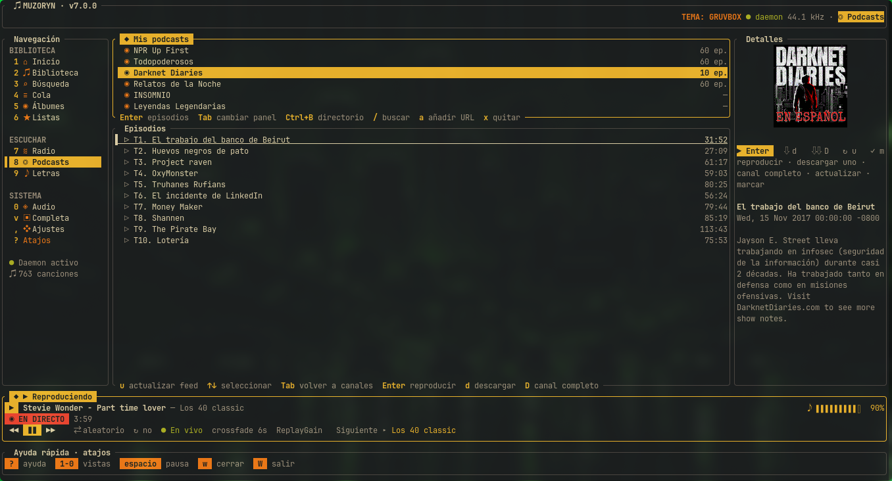

# 🎙️ Podcasts

Pulsa `8`.



## Mis podcasts y episodios
`Tab` alterna entre la lista **Mis podcasts** y los **episodios** del canal seleccionado. El panel de detalles muestra carátula, título, fecha y descripción.

| Tecla | Acción |
|---|---|
| `Enter` | Muestra los episodios (en la lista de canales) o reproduce (en un episodio) |
| `a` / `Ctrl+A` | Añadir un feed RSS por URL (nombre personalizado o el del feed). `x` dos veces lo quita |
| `u` | Actualizar el feed del canal seleccionado |
| `m` / `M` | Marcar o desmarcar un episodio (✓) / quitar todas las marcas |
| `d` | Descargar el episodio (o todos los marcados) |
| `D` | Descargar el canal completo |
| `Ctrl+D` / `F3` | Gestor de descargas ([ver Descargas](descargas.md)) |
| `/` | Buscar podcasts en español |
| `Ctrl+B` | Abrir el directorio |

El episodio se reproduce en **streaming** con un búfer en memoria (canal acotado de 512 bloques de 8 KiB, unos 4 MiB), sin descargarlo entero antes. Si la conexión se interrumpe conserva lo recibido e intenta reanudar desde el byte pendiente mediante HTTP Range, si el servidor lo permite.

Duración del búfer aproximada: 128 kbps ≈ 4 min 22 s · 256 kbps ≈ 2 min 11 s · 320 kbps ≈ 1 min 46 s.

La barra de progreso usa la duración publicada en el feed (`itunes:duration`); si el feed no la publica y el decodificador no puede determinarla, no se puede mostrar un porcentaje fiable.

## Directorio de podcasts en español
Usa el directorio público de Apple Podcasts (sin cuenta ni clave), con términos y categorías en español y una tienda hispanohablante.

| Tecla | Acción |
|---|---|
| `/` | Buscar por nombre o tema (p. ej. `historia de México`); hasta 50 resultados |
| `Ctrl+B` | Abrir el directorio |
| `←` / `→` | Alternar entre **Populares** y **Categorías** |
| `Enter` | En una categoría la abre; en un podcast **lo suscribe y abre sus episodios** |
| `f` | Suscribirse o cancelar sin abrirlo (✓ marca los suscritos) |
| `u` | En **Populares**, recarga el catálogo |
| `Esc` | Sale de una categoría; otra vez, sale del explorador y vuelve a Mis podcasts |

Las 19 categorías están en español: Noticias, Tecnología, Crimen real, Comedia, Sociedad y cultura, Historia, Ciencia, Salud y bienestar, Negocios, Música, Deportes, Arte, Educación, Ficción, TV y cine, Religión y espiritualidad, Niños y familia, Ocio y Gobierno.

**País de la tienda:** `podcast_country` en `settings.toml` (2 letras; por defecto `mx`): `es`, `ar`, `co`, `cl`, `pe`, `us`…

**Límites:** Apple no indica el idioma de cada podcast, así que puede colarse alguno en otro idioma. Si el directorio no responde (sin red o bloqueado en tu país), se muestra el error y puedes seguir añadiendo feeds con `a`.

## Suscripciones en el archivo de ajustes
Se guardan como bloques `[[podcasts]]`. Editarlos a mano sigue funcionando; al entrar en Podcasts se incorporan los nuevos.

```toml
[[podcasts]]
name = "Mi podcast"
url = "https://ejemplo.org/feed.xml"
```
