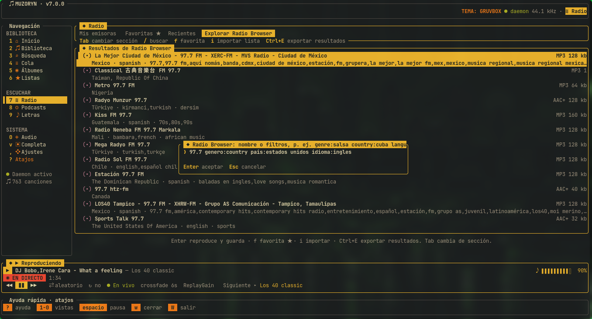
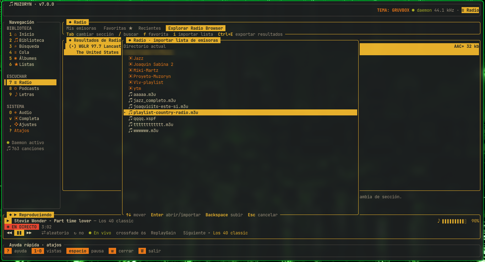

# 📻 Radio

Pulsa `7`. `Tab` recorre las secciones: **Mis emisoras → Favoritas ★ → Recientes → Explorar Radio Browser**.



## Añadir emisoras
- **Por URL:** `a` (o `Ctrl+A`) → pega la dirección del stream → Enter → escribe un nombre o déjalo vacío (se usa el que anuncia el stream, o el dominio). `x` dos veces la quita.
- **Desde Radio Browser:** `Tab` hasta *Explorar Radio Browser* → `/` → escribe la búsqueda → `Enter` reproduce y guarda la emisora (si ya estaba guardada no se duplica).
- **Editando `settings.toml`:** los bloques `[[stations]]` siguen funcionando; al entrar en Radio se incorporan los nuevos.
- **Importando un archivo:** ver más abajo.

## Radio Browser
Busca por nombre o con filtros, en español o en inglés:

```text
género:salsa país:cuba idioma:español
genre:salsa country:cuba language:Spanish
```

MUZORYN traduce idiomas (español, inglés, francés…) y los géneros más comunes (clásica, noticias, deportes, reguetón…) al nombre que usa Radio Browser. Lo que no reconoce se envía tal cual. La búsqueda requiere Internet; tu lista local funciona sin conexión.

## Favoritas y recientes
- `f` marca o desmarca la emisora seleccionada (también un resultado de Radio Browser, que además se añade a *Mis emisoras*). Desde otra vista, `f` marca la emisora que está sonando. Se guarda como `fav = true`.
- **Recientes:** las últimas 10 emisoras (`recent_stations`). En esa sección `x` solo la quita del historial.

## Mientras suena
- **Canción en vivo:** si la emisora envía metadatos ICY se muestra *artista – canción* y, debajo, el nombre de la emisora. Si no, la emisora y su género.
- **Estados:** *Conectando…*, *En vivo*, *Reconectando…*, *Emisora no disponible*.
- **Reconexión:** si el flujo se corta, reintenta solo con esperas de 0, 2, 5, 10, 20 y 30 s; si todos fallan, se detiene y avisa.
- **Conexión lenta:** abrir una emisora no bloquea la interfaz; si falla, sigue sonando lo anterior. `s` cancela. El audio se lee con ~1 MiB de antelación.
- Las emisoras en directo no admiten buscar dentro de la pista.

## Importar y exportar emisoras (7.0)



| Tecla | Acción |
|:-:|---|
| `i` | Abre un navegador de archivos filtrado a `.m3u`, `.m3u8`, `.pls`, `.xspf` y `.json`. `↑`/`↓` mueven, `Enter` abre carpeta o importa, `Backspace` sube, `Esc` cancela |
| `Ctrl+E` | Exporta |

- **Importar** añade a tus emisoras y **omite URLs duplicadas**; no sustituye la lista guardada. Solo se aceptan `http://` y `https://`, y se conserva el orden.
- **Exportar** crea los cinco formatos (M3U, M3U8, PLS, XSPF y JSON) en `~/.local/share/muzoryn/exports/radio/` (o el equivalente según `XDG_DATA_HOME` / `MUZORYN_DATA_DIR`). En *Mis emisoras* exporta las guardadas; en *Radio Browser*, **todos** los resultados de la búsqueda actual (aún no hay selección múltiple de resultados).
- La importación desde una URL remota no está disponible: se importan archivos locales.

## Privacidad
Al reproducir una emisora que vino de Radio Browser se envía a su API **solo el identificador** (`stationuuid`) para contar su popularidad. Se desactiva con `radio_click_count = false`. Las emisoras añadidas por URL no envían nada. Ver [Seguridad y privacidad](seguridad.md).

## Teclas multimedia
Ver [Daemon y control externo](daemon-y-control.md).
