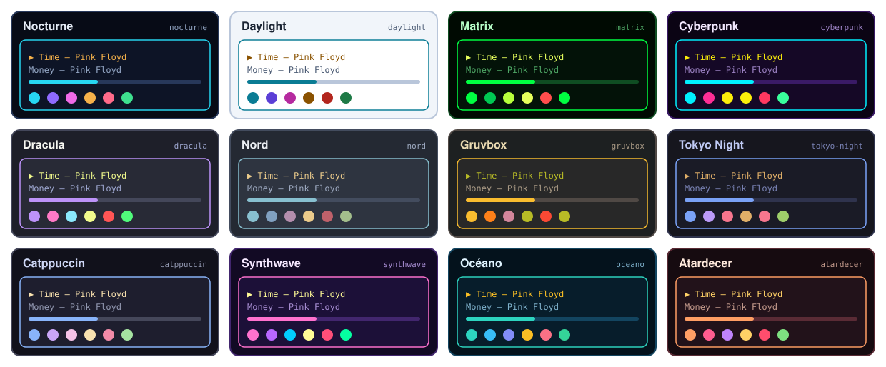

# 🎨 Temas y terminales

## Temas
12 temas incluidos: **nocturne, daylight, matrix, cyberpunk, dracula, nord, gruvbox, tokyo-night, catppuccin, synthwave, oceano, atardecer**.

- Pulsa `T` para recorrer los temas, o ve a **Ajustes → Temas** (`↑`/`↓` y `Enter` aplican el tema).
- Al arrancar: `MUZORYN_THEME=matrix muzoryn`.
- Fijo: `theme = "nord"` en `settings.toml`.
- Propio: copia un archivo de `themes/`, cambia los colores y usa su ruta (`MUZORYN_THEME=/ruta/mi-tema.toml`).

## Visualizador
`b` alterna entre 10 estilos: Segmentos, Mosaico, Led, Medidor, Matriz, Espejo, Braille, Onda, Pulso y Aurora. El espectro se calcula de las muestras reales que suenan.

## Fuente
Instala una [Nerd Font](https://www.nerdfonts.com/font-downloads) (por ejemplo *JetBrainsMono Nerd Font*) y selecciónala en tu terminal; sin ella los iconos de carpeta pueden verse como ▯.

## Quitar el padding de la terminal
MUZORYN pinta el fondo de la terminal con el color del tema (secuencia OSC 11) y lo restaura al salir; se desactiva con `MUZORYN_NO_OSC=1`. Para que la interfaz ocupe todo el espacio:

| Terminal | Archivo | Opciones |
|---|---|---|
| Kitty | `kitty.conf` | `window_padding_width 0` y `placement_strategy top-left` |
| Alacritty | `alacritty.toml` | `[window]` → `padding = { x = 0, y = 0 }` y `dynamic_padding = false` |
| foot | `foot.ini` | `[main]` → `pad=0x0` |
| Ghostty | `config` | `window-padding-x = 0`, `window-padding-y = 0`, `window-padding-color = extend` |
| WezTerm | `wezterm.lua` | `config.window_padding = { left = 0, right = 0, top = 0, bottom = 0 }` |

Si ves un borde de color alrededor, suele venir del gestor de ventanas (p. ej. `col.active_border` en Hyprland) o de la transparencia, no de MUZORYN.

## Carátulas en alta resolución
| Terminal | Protocolo |
|---|---|
| Kitty · WezTerm · Ghostty | Kitty |
| iTerm2 · mintty | iTerm2 |
| foot · mlterm · Konsole | Sixel |
| Cualquier otra, y dentro de **tmux** | Medios bloques (96 px) |

Se muestran en resolución real (hasta 512 px). Para forzar un modo: `MUZORYN_GRAPHICS=kitty|iterm|sixel|blocks muzoryn`. Las carátulas salen de la etiqueta embebida, de `cover`/`folder`/`front.jpg` o de la imagen del feed del podcast. Al cambiar de pista se conserva la carátula anterior mientras carga la nueva (y se precarga la de la siguiente), para evitar parpadeos en Kitty, iTerm2 y Sixel.
